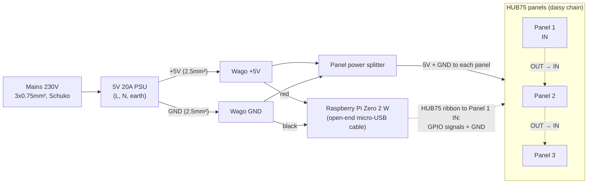

# ptrans-rgb
Display public transport data in Vienna and what's currently playing on Spotify from data provided by [ptrans-data](https://github.com/lerchl/ptrans-data) configured through [ptrans-ui](https://github.com/lerchl/ptrans-ui).

## Electrical setup

